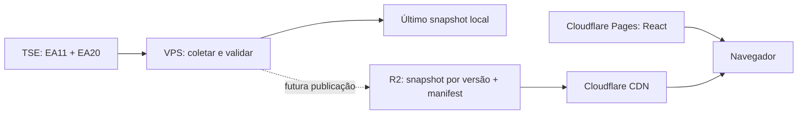

# Brasil Decide 2026

Aplicação independente para acompanhar **somente Presidente da República, segundo turno de 25/10/2026**. Sem vínculo com a Justiça Eleitoral. Fonte dos resultados: TSE. Liderança em votos não representa declaração de eleição.

## Fase 1

Monorepo com backend Java 21, Spring Boot 3.5, Maven e dashboard React/Vite/TypeScript implementado na Fase 2. Sem banco de dados obrigatório ou votos demonstrativos em produção. O frontend mantém um cadastro local de nomes, partidos, números e fotos das duas candidaturas em `frontend/src/candidates.ts`, exibido também enquanto aguarda resultados; os votos e percentuais vêm exclusivamente dos snapshots validados.

Implementado: descoberta EA11, parser EA20 presidencial por abrangência, coleta configurável com até quatro consultas simultâneas às UFs, validação de identidade e totais, ETag/Last-Modified/304, timeout e retry com backoff para erros transitórios, circuito com espera após falhas, último snapshot válido, persistência com rename atômico, status de atraso, API REST e testes com arquivos oficiais. Coletas completas trocam a referência em memória somente após a gravação no disco. Arquivos que regredirem em data/hora são rejeitados; correções de votos em gerações novas são permitidas.

**Coleta desativada por padrão.** Ative `TSE_ENABLED=true` quando quiser consultar a fonte. Sem snapshot ou eleição confirmada, a API retorna 503, nunca votos fictícios. Se uma UF falhar, toda a atualização é descartada; isso preserva uma versão completa, mas pode atrasar a atualização nacional. Arquivos distintos não são transacionais no TSE; `atualizadoEm` e `geracao` pertencem a cada abrangência.

## Executar

Requisitos: Java 21 e Maven 3.9+, ou Docker Compose.

O Maven Wrapper oficial está em `backend`. Sem Maven global: no Linux/macOS, `cd backend && ./mvnw verify`; no PowerShell, entre em `backend` e execute `.\mvnw.cmd verify`. A primeira execução baixa o Maven e as dependências. Para iniciar via wrapper, execute `spring-boot:run` no lugar de `verify`.

```sh
mvn -B -f backend/pom.xml verify
mvn -f backend/pom.xml spring-boot:run
curl http://localhost:8080/api/v1/results/status
curl http://localhost:8080/actuator/health
```

```sh
cp .env.example .env
docker compose up --build -d
docker compose logs -f backend
```

No PowerShell, use `Copy-Item .env.example .env`. O Compose expõe a API somente em `127.0.0.1:8080`. Snapshots são gravados no volume `/data`; em execução local, `data/current.json`. A gravação exige suporte a rename atômico no mesmo filesystem. O processo não publica nada em serviços externos.

Neste computador, o Maven precisou usar os certificados confiáveis do Windows: opções `-Djavax.net.ssl.trustStoreType=Windows-ROOT -Djavax.net.ssl.trustStore=NONE` (entre aspas no PowerShell). Essa configuração é local e não desabilita a verificação TLS. Após iniciar o Docker Desktop, a imagem foi construída e executada com sucesso; os 15 testes passaram no build e o Compose confirmou o container saudável. Consulte [a validação](docs/validacao.md).

## Arquitetura



Os resultados públicos são distribuídos por snapshots, sem consultas dos visitantes à API interna de resultados. O contador opcional de visitas é encaminhado ao backend pelo Nginx do frontend. O Docker limita heap a 768 MB e container a 1280 MB, deixando espaço para sistema e infraestrutura. CORS não é aberto na API interna. Apenas `/actuator/health` é exposto no Actuator.

A distribuição proposta é **Pages para assets estáticos e R2 com domínio próprio e cache para JSON**, sem novos deployments do Pages a cada coleta. O frontend, seu leitor de manifest/snapshot, os testes de responsividade e o publicador R2 estão implementados. A configuração externa do R2 e os testes de carga k6 ainda são etapas futuras. Ver [arquitetura de publicação](docs/publicacao.md).

A implantação na VPS está registrada em [visitas](docs/visitas.md), incluindo a publicação do contador em 10/10/2026. O [CI/CD](.github/workflows/ci.yml) valida pushes em `main` com testes do frontend/backend e das imagens antes da publicação, quando `AUTO_DEPLOY=true`. A [execução de 11/10/2026](https://github.com/pbosoares/Brasil-Decide2026/actions/runs/38168635978) concluiu a publicação com sucesso. Não há medição de 100 mil visitantes; esta capacidade é uma meta que exige testes distribuídos, cache real e orçamento verificado.

## Documentação e validação

- [Contrato da API](docs/api.md)
- [Referências TSE e procedência das fixtures](docs/tse/README.md)
- [Publicação, custos e deploy](docs/publicacao.md)
- [Frontend e comandos](frontend/README.md)
- [Contrato dos snapshots públicos](docs/snapshots-publicos.md)

Os testes de parser usam arquivos **oficiais históricos do primeiro turno**, armazenados apenas em `src/test/resources`, para validar o formato real e os totais. A produção aceita exclusivamente o segundo turno de 2026. Ainda não há fixture oficial do segundo turno nesta entrega. Os casos adversos derivam desses arquivos em memória; estruturas sintéticas sem votos são identificadas como SIMULAÇÃO DE TESTE.

EA11, EA15, EA20 e instruções de download foram consultados. O link do PDF EA14 retornou erro/403 nesta sessão; o JSON oficial de acompanhamento Brasil foi obtido e preservado como referência, mas a revisão integral desse PDF permanece pendente. A coleta da Fase 1 usa diretamente os arquivos EA20; otimização por EA14/EA15 só deve ser adicionada após essa revisão.

## Fase 2 — dashboard local

Dashboard React responsivo em português, tema escuro, placar presidencial, estatísticas, mapa SVG do IBGE com 27 UFs, painel estadual, tabela com busca/ordenação e histórico de atualizações recebidas. O leitor de snapshots públicos valida dados, versões, turno e fase, com polling de 5–6 segundos na página visível e fallback para o último resultado aceito. Em produção, consome snapshots publicados; na prévia local, o Vite encaminha o manifest e os snapshots para o backend local.

```sh
cd frontend
npm ci
npm run dev
```

Prévia de desenvolvimento em http://127.0.0.1:5173. Com `VITE_RESULTS_MANIFEST_URL` vazio, o Vite encaminha `/results/*` ao backend local em `127.0.0.1:8080`; sem backend, a interface permanece disponível e informa falha na consulta, preservando eventual snapshot válido do navegador. Para visualizar o manifest estático de espera sem backend, execute `npm run build` e `npm run preview`, com a variável vazia durante o build, e abra http://127.0.0.1:4173. Os perfis e fotos locais das candidaturas aparecem mesmo sem resultados; votos e percentuais aguardam dados oficiais. O gráfico é carregado sob demanda quando existe histórico. O contador opcional usa `POST /api/v1/visits`, encaminhado ao backend pelo Nginx do frontend. `npm test`, `npm run build` e `npm run test:e2e` são descritos no README do frontend.

## Próxima fase

Publicador R2 implementado com envio confirmado de snapshots, manifest condicional, status periódico e recuperação após reinício. Configuração externa ainda pendente: criar bucket, credencial limitada, domínio de dados e regras de cache/CORS conforme [publicação](docs/publicacao.md). Revisar a pendência do EA14. Depois validar cache e medir carga em ambiente autorizado. Não realizar deploy ou contratar serviços sem autorização.
