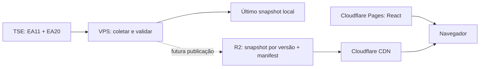

# Brasil Decide 2026

Aplicação independente para acompanhar **somente Presidente da República, segundo turno de 25/10/2026**. Sem vínculo com a Justiça Eleitoral. Fonte dos resultados: TSE. Liderança em votos não representa declaração de eleição.

## Fase 1

Monorepo com backend Java 21, Spring Boot 3.5, Maven e diretório reservado para o dashboard React da Fase 2. Sem banco de dados obrigatório, nomes fixos de candidatos ou votos demonstrativos em produção.

Implementado: descoberta EA11, parser EA20 presidencial por abrangência, coleta sequencial configurável, validação de identidade e totais, ETag/Last-Modified/304, timeout e retry com backoff para erros transitórios, circuito com espera após falhas, último snapshot válido, persistência com rename atômico, status de atraso, API REST e testes com arquivos oficiais. Coletas completas trocam a referência em memória somente após a gravação no disco. Arquivos que regredirem em data/hora são rejeitados; correções de votos em gerações novas são permitidas.

**Coleta desativada por padrão.** Ative `TSE_ENABLED=true` quando quiser consultar a fonte. Sem snapshot ou eleição confirmada, a API retorna 503, nunca votos fictícios. Se uma UF falhar, toda a atualização é descartada; isso preserva uma versão completa, mas pode atrasar a atualização nacional. Arquivos distintos não são transacionais no TSE; `atualizadoEm` e `geracao` pertencem a cada abrangência.

## Executar

Requisitos: Java 21 e Maven 3.9+, ou Docker Compose.

O Maven Wrapper oficial está em `backend`. Sem Maven global: no Linux/macOS, `cd backend && ./mvnw verify`; no PowerShell, entre em `backend` e execute `.\mvnw.cmd verify`. A primeira execução baixa o Maven e as dependências. Para iniciar via wrapper, execute `spring-boot:run` no lugar de `verify`.

```sh
mvn -B -f backend/pom.xml verify
mvn -f backend/pom.xml spring-boot:run
curl http://localhost:8080/api/v1/results/status
curl http://localhost:8080/actuator/health
```

```sh
cp .env.example .env
docker compose up --build -d
docker compose logs -f backend
```

No PowerShell, use `Copy-Item .env.example .env`. O Compose expõe a API somente em `127.0.0.1:8080`. Snapshots são gravados no volume `/data`; em execução local, `data/current.json`. A gravação exige suporte a rename atômico no mesmo filesystem. O processo não publica nada em serviços externos.

Neste computador, o Maven precisou usar os certificados confiáveis do Windows: opções `-Djavax.net.ssl.trustStoreType=Windows-ROOT -Djavax.net.ssl.trustStore=NONE` (entre aspas no PowerShell). Essa configuração é local e não desabilita a verificação TLS. O Docker daemon estava indisponível nesta sessão; a imagem não foi executada.

## Arquitetura



A API interna não recebe tráfego de visitantes. A VPS de 1 vCPU / 4 GB é dedicada à coleta e publicação. O Docker limita heap a 768 MB e container a 1280 MB, deixando espaço para sistema e infraestrutura. CORS não é aberto na API interna. Apenas `/actuator/health` é exposto no Actuator.

A distribuição proposta é **Pages para assets estáticos e R2 com domínio próprio e cache para JSON**, sem novos deployments do Pages a cada coleta. Publicador R2, manifest público, frontend, testes de responsividade e k6 pertencem às fases seguintes e ainda não estão implementados. Ver [arquitetura de publicação](docs/publicacao.md).

Não houve deploy, contratação de serviços nem medição de 100 mil visitantes. Esta capacidade é uma meta que exige testes distribuídos, cache real e orçamento verificado.

## Documentação e validação

- [Contrato da API](docs/api.md)
- [Referências TSE e procedência das fixtures](docs/tse/README.md)
- [Publicação, custos e deploy](docs/publicacao.md)

Os testes de parser usam arquivos **oficiais históricos do primeiro turno**, armazenados apenas em `src/test/resources`, para validar o formato real e os totais. A produção aceita exclusivamente o segundo turno de 2026. Ainda não há fixture oficial do segundo turno nesta entrega. Os casos adversos derivam desses arquivos em memória; estruturas sintéticas sem votos são identificadas como SIMULAÇÃO DE TESTE.

EA11, EA15, EA20 e instruções de download foram consultados. O link do PDF EA14 retornou erro/403 nesta sessão; o JSON oficial de acompanhamento Brasil foi obtido e preservado como referência, mas a revisão integral desse PDF permanece pendente. A coleta da Fase 1 usa diretamente os arquivos EA20; otimização por EA14/EA15 só deve ser adicionada após essa revisão.

## Próxima fase

Dashboard React responsivo em português, tema escuro, placar presidencial, estatísticas, mapa com 27 UFs, painel estadual e tabela. Antes de integrar, implementar o publicador R2 e o contrato de manifest, com fallback e jitter no navegador. Dados ausentes devem renderizar estado de espera, e dados atrasados devem permanecer visíveis com aviso.
